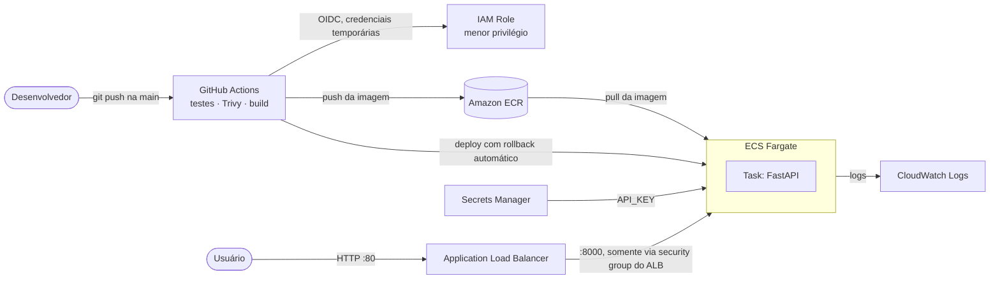
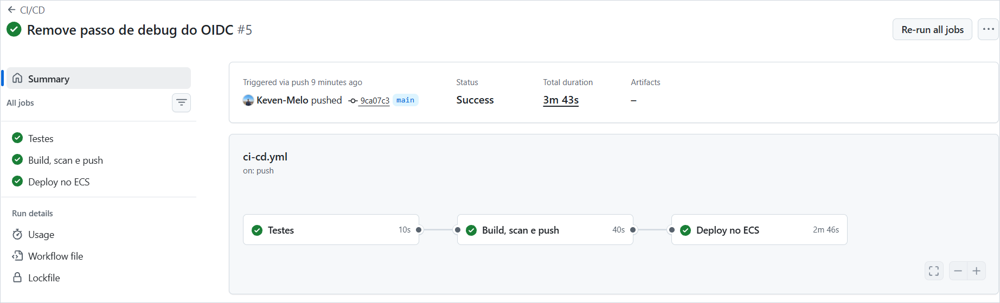
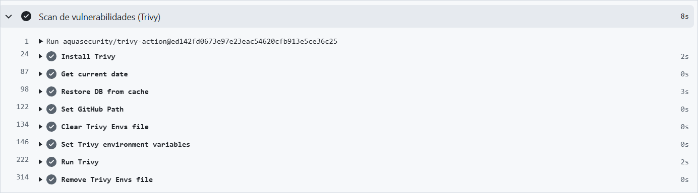
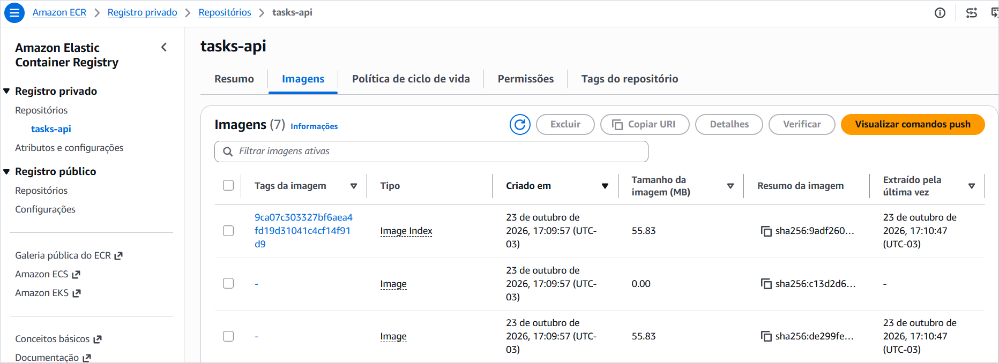
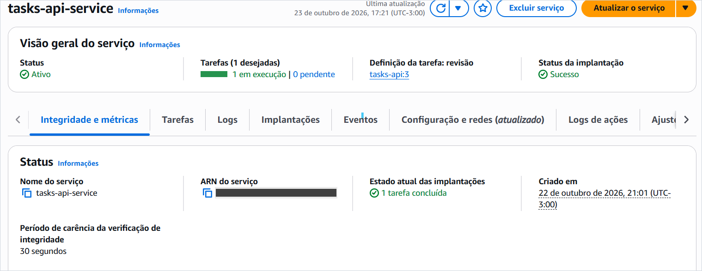
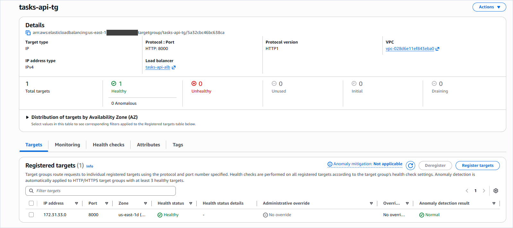
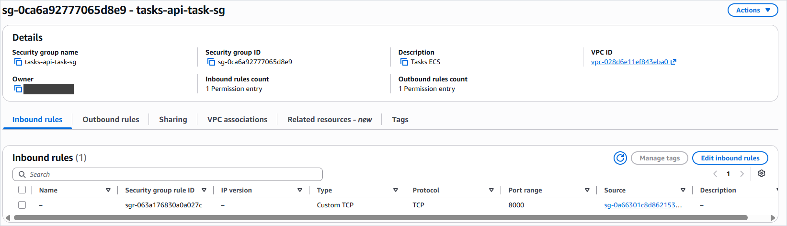
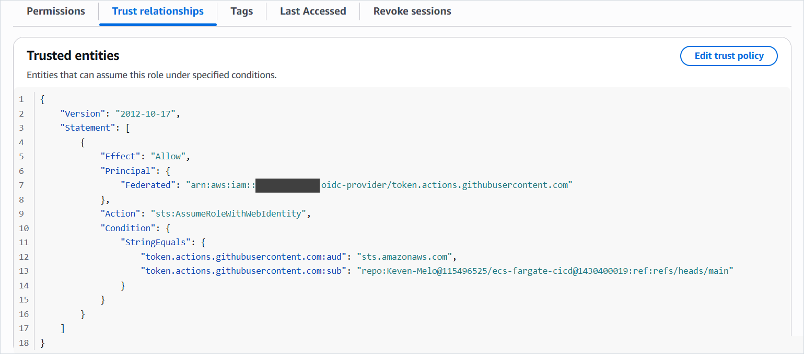
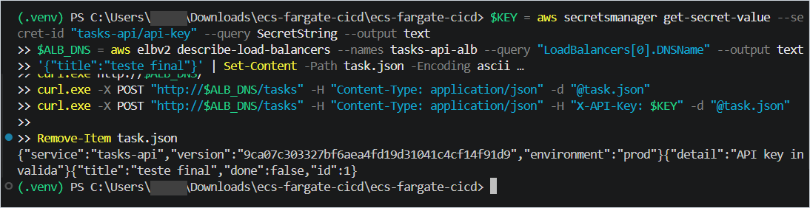

# ECS Fargate + CI/CD na AWS

[](https://github.com/Keven-Melo/ecs-fargate-cicd/actions/workflows/ci-cd.yml)

API containerizada rodando no **Amazon ECS Fargate** atrás de um **Application Load Balancer**. Um pipeline no **GitHub Actions** testa o código, escaneia a imagem em busca de vulnerabilidades, publica no **Amazon ECR** e faz o deploy automático, com rollback se a nova versão não ficar saudável. O pipeline acessa a AWS por **OIDC**, sem nenhuma chave de acesso guardada.

> **Projeto 1 de 3** do meu portfólio DevOps na AWS.
> Semana 1: ECS Fargate + CI/CD (este repositório) → Semana 2: Terraform multi-ambiente → Semana 3: DevSecOps.

## Destaques

- **Entrega contínua completa:** push na `main` leva a um deploy no ECS, sem passos manuais.
- **Sem credenciais de longa duração:** o GitHub assume uma role temporária via OIDC, restrita a este repositório e à branch `main`.
- **Segurança no pipeline:** scan de vulnerabilidades com Trivy bloqueia a imagem com falhas `CRITICAL` ou `HIGH` corrigíveis, e a action de terceiros é fixada por SHA do commit.
- **Segredos fora do código:** a chave da API fica no Secrets Manager e é injetada pelo ECS como variável de ambiente.
- **Rede em camadas:** só o ALB é público; as tasks aceitam tráfego apenas do security group do ALB.
- **Versões rastreáveis:** a imagem é marcada com o hash do commit e a API expõe essa versão em `/`.

## Arquitetura



## Evidências

A infraestrutura foi criada, validada e **destruída ao fim do laboratório** para não gerar custo. Os registros abaixo documentam a execução.

### Pipeline de CI/CD



Os três estágios aprovados: testes, build com scan e push, e deploy no ECS.

### Scan de vulnerabilidades



O Trivy roda a cada build. A action é referenciada pelo SHA do commit (`ed142fd…`, versão v0.36.0), e não por uma tag que pode ser reescrita.

### Imagens versionadas no ECR



Cada imagem recebe como tag o hash do commit que a originou (`9ca07c3…`), o que torna qualquer deploy rastreável e reproduzível. Não há tag `latest`.

### Serviço no ECS Fargate



Serviço ativo, task em execução e deploy concluído com sucesso. A definição de tarefa está na revisão 3: a 1 foi o registro manual inicial, e as revisões 2 e 3 foram criadas pelo pipeline.

### Health check do load balancer



O ALB consulta `/health` periodicamente e só envia tráfego a containers saudáveis. O target group `tasks-api-tg` aparece com 1 target registrado e `Healthy`.

### Rede em camadas



O security group das tasks tem uma única regra de entrada: porta 8000, com origem no security group do ALB (e não em um bloco de IPs). Mesmo com IP público, as tasks não recebem conexões diretas da internet.

### Autenticação por OIDC (sem chaves de acesso)



Política de confiança da role `tasks-api-github-deploy`: somente o repositório e a branch `main` indicados na condição `sub` conseguem assumir a role. Os dados da conta foram ocultados.

### API em produção



Pela URL do ALB: a rota `/` mostra a versão (hash do commit) e `environment=prod`; o `POST` sem chave é recusado (`API key invalida`) e, com a chave vinda do Secrets Manager, cria a task.

## Stack

| Camada | Tecnologia |
|---|---|
| Aplicação | Python 3.12, FastAPI, Uvicorn |
| Container | Docker multi-stage, usuário não-root, healthcheck |
| Registry | Amazon ECR (scan ao enviar) |
| Orquestração | Amazon ECS Fargate |
| Entrada de tráfego | Application Load Balancer |
| Segredos | AWS Secrets Manager |
| Observabilidade | CloudWatch Logs |
| CI/CD | GitHub Actions + OIDC |
| Segurança no pipeline | Trivy (imagem), actions fixadas por SHA |

## Pipeline

1. **Testes:** `pytest` em todo push e pull request.
2. **Build e scan:** monta a imagem e roda o Trivy. Vulnerabilidades `CRITICAL` ou `HIGH` com correção disponível reprovam o pipeline.
3. **Push:** apenas na `main`, publica a imagem no ECR com a tag do commit.
4. **Deploy:** renderiza a task definition com a nova imagem e atualiza o serviço ECS, aguardando a estabilidade.

Pull requests executam só os passos 1 e 2, sem acesso à AWS.

## Decisões técnicas

- **OIDC em vez de access keys:** não há credencial de longa duração em secrets. A role só pode ser assumida pela branch `main` deste repositório, e a condição usa comparação exata (`StringEquals`).
- **Fargate com IP público, sem NAT Gateway:** reduz o custo do ambiente de estudo. As tasks só aceitam tráfego do security group do ALB. A migração para subnets privadas está planejada para a semana 2.
- **Deployment circuit breaker com rollback:** se a nova versão não ficar saudável, o ECS volta sozinho para a anterior.
- **Imagem multi-stage e não-root:** menos pacotes na imagem final e menor impacto em caso de exploração.
- **Tag por commit:** cada deploy é rastreável, e a API expõe a versão em execução.
- **Privilégio mínimo no IAM:** a role de deploy só publica no repositório ECR indicado, atualiza um único serviço e repassa apenas a role de execução ao ECS.
- **Actions de terceiros fixadas por SHA:** tags podem ser reescritas; o hash do commit não.

## Problemas enfrentados e aprendizados

| Problema | Causa | Solução |
|---|---|---|
| `Unable to resolve action trivy-action@0.28.0` | Após um incidente de supply chain reportado no Trivy em março de 2026, as tags antigas da action foram removidas e republicadas com o prefixo `v` ([notas de release](https://github.com/aquasecurity/trivy-action/releases)) | Atualizei para a v0.36.0 e passei a **fixar a action pelo SHA do commit** |
| `Not authorized to perform sts:AssumeRoleWithWebIdentity` | O `sub` do token OIDC do meu repositório trazia os IDs numéricos do dono e do repositório, e minha política esperava o formato sem IDs | Adicionei ao workflow um passo temporário que imprimia os claims do token (sem o token em si), comparei com a política e a atualizei com o `sub` exato |
| `Invalid workflow file` | Um bloco YAML colado no job e na indentação errados | Substituí o arquivo inteiro e validei a estrutura antes de enviar |
| `curl` falhando com JSON no PowerShell | O PowerShell divide argumentos com espaços e trata aspas de outra forma | Passei a enviar o corpo por arquivo (`-d @arquivo.json`) |
| Variáveis perdidas ao reabrir o terminal | O PowerShell não persiste variáveis entre sessões | Recupero os valores pelo nome dos recursos (ver `docs/aws-setup.md`) |
| Uso da conta root na CLI | A conta nova estava configurada com credenciais root | Criei um usuário IAM dedicado e substituí as credenciais da CLI |
| Serviço ECS sem imagem para subir | O pipeline só atualiza um serviço que já existe, e o serviço precisa de uma imagem | Publiquei manualmente a primeira imagem (`bootstrap`) e o pipeline assumiu a partir daí |

## Endpoints

| Método | Rota | Autenticação |
|---|---|---|
| GET | `/health` | não |
| GET | `/` | não |
| GET | `/tasks`, `/tasks/{id}` | não |
| POST | `/tasks` | `X-API-Key` |
| PUT / DELETE | `/tasks/{id}` | `X-API-Key` |

A chave vem do Secrets Manager e é injetada como variável de ambiente `API_KEY` pelo ECS. Em desenvolvimento local, sem `API_KEY`, a verificação é ignorada.

## Rodando localmente

PowerShell (Windows):

```powershell
python -m venv .venv
.venv\Scripts\Activate.ps1
pip install -r requirements-dev.txt
pytest -q
uvicorn app.main:app --reload
```

Bash (Linux/macOS):

```bash
python3 -m venv .venv && source .venv/bin/activate
pip install -r requirements-dev.txt
pytest -q
uvicorn app.main:app --reload
```

Com Docker:

```bash
docker build -t tasks-api .
docker run --rm -p 8000:8000 -e API_KEY=minha-chave tasks-api
curl localhost:8000/health
```

A documentação interativa da API fica em `http://localhost:8000/docs`.

## Reproduzindo na AWS

O passo a passo para criar toda a infraestrutura (ECR, Secrets Manager, IAM, rede, ALB, ECS e OIDC) e para destruí-la está em [`docs/aws-setup.md`](docs/aws-setup.md), com notas específicas para quem usa PowerShell. Na semana 2 essa infraestrutura é reescrita em Terraform.

## Custos

Com 1 task Fargate (0,25 vCPU, 512 MB) e 1 ALB, o custo fica em torno de **US$ 1,50 a 2 por dia ligado** (valores aproximados na `us-east-1`; confirme na [calculadora da AWS](https://calculator.aws/)). Para estudar com segurança:

- Crie um **AWS Budget** com alerta antes de começar.
- Zere o `desired-count` e apague o ALB quando não estiver testando.
- Destrua tudo ao fim da sessão (seção 9 do `docs/aws-setup.md`).

## Limitações conhecidas e próximos passos

| Limitação | Resolução planejada |
|---|---|
| Dados em memória: cada task tem sua própria lista | Banco de dados (DynamoDB ou RDS) |
| Apenas HTTP | HTTPS com ACM + Route 53 |
| VPC default e infraestrutura criada manualmente | VPC própria e Terraform multi-ambiente (semana 2) |
| Scan somente da imagem | Checkov, SAST e GuardDuty (semana 3) |
| Sem alertas | Alarmes no CloudWatch + SNS |
| Rollback validado apenas pela configuração do circuit breaker | Teste de deploy com falha induzida |

## Estrutura

```
.
├── app/                        # código da API
├── tests/                      # testes com pytest
├── ecs/task-definition.json    # definição da task no ECS
├── docs/
│   ├── aws-setup.md            # criação e destruição da infraestrutura
│   └── img/                    # evidências usadas neste README
├── .github/workflows/ci-cd.yml # pipeline
├── Dockerfile
└── requirements-dev.txt
```

## Autor

[@Keven-Melo](https://github.com/Keven-Melo)
