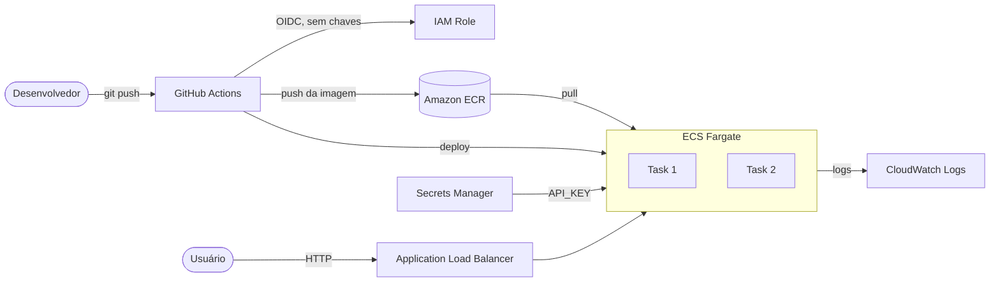

# ECS Fargate + CI/CD na AWS

API containerizada rodando no **Amazon ECS Fargate** atrás de um **Application Load Balancer**, com pipeline no **GitHub Actions** que testa, escaneia vulnerabilidades, publica no **ECR** e faz deploy automático com rollback.

> Projeto 1 de 3 do meu portfólio DevOps na AWS.
> Semana 1: ECS Fargate + CI/CD (este repositório) → Semana 2: Terraform multi-ambiente → Semana 3: DevSecOps.

## Arquitetura



## Stack

| Camada | Tecnologia |
|---|---|
| Aplicação | Python 3.12, FastAPI, Uvicorn |
| Container | Docker multi-stage, usuário não-root, healthcheck |
| Registry | Amazon ECR (scan ao enviar) |
| Orquestração | Amazon ECS Fargate (2 tasks) |
| Entrada de tráfego | Application Load Balancer |
| Segredos | AWS Secrets Manager |
| Observabilidade | CloudWatch Logs |
| CI/CD | GitHub Actions + OIDC |
| Segurança no pipeline | Trivy (imagem) |

## Estrutura

```
.
├── app/                    # código da API
├── tests/                  # testes com pytest
├── ecs/task-definition.json
├── docs/aws-setup.md       # passo a passo para criar a infra na AWS
├── .github/workflows/ci-cd.yml
├── Dockerfile
└── requirements-dev.txt
```

## Rodando localmente

```bash
python -m venv .venv && source .venv/bin/activate
pip install -r requirements-dev.txt
pytest -q
uvicorn app.main:app --reload
```

Com Docker:

```bash
docker build -t tasks-api .
docker run --rm -p 8000:8000 -e API_KEY=minha-chave tasks-api
curl localhost:8000/health
```

Documentação interativa em `http://localhost:8000/docs`.

## Endpoints

| Método | Rota | Auth |
|---|---|---|
| GET | `/health` | não |
| GET | `/` | não |
| GET | `/tasks`, `/tasks/{id}` | não |
| POST | `/tasks` | `X-API-Key` |
| PUT / DELETE | `/tasks/{id}` | `X-API-Key` |

A chave vem do Secrets Manager e é injetada como variável de ambiente `API_KEY` pelo ECS.

## Pipeline

1. **Testes:** `pytest` em todo push e pull request.
2. **Build e scan:** monta a imagem e roda o Trivy. Vulnerabilidades `CRITICAL` ou `HIGH` com correção disponível reprovam o pipeline.
3. **Push:** somente na `main`, publica a imagem no ECR com a tag do commit (`github.sha`).
4. **Deploy:** renderiza a task definition com a nova imagem e atualiza o serviço ECS, aguardando estabilidade.

Pull requests só executam os passos 1 e 2, sem acesso à AWS.

## Decisões técnicas

- **OIDC em vez de access keys:** o GitHub assume uma role temporária. Nada de credencial de longa duração em secrets, e a role só pode ser assumida pela branch `main` deste repositório.
- **Fargate com IP público, sem NAT Gateway:** reduz custo no ambiente de estudo. As tasks só aceitam tráfego do security group do ALB. Na semana 2 migra para subnets privadas.
- **Deployment circuit breaker com rollback:** se a nova versão não ficar saudável, o ECS volta sozinho para a anterior.
- **Imagem multi-stage, não-root:** menor superfície de ataque e menos vulnerabilidades reportadas pelo scan.
- **Tag por commit (não `latest`):** cada deploy é rastreável e reproduzível.
- **Privilégio mínimo no IAM:** a role de deploy só publica no repositório ECR e atualiza o serviço específico.

## Limitações conhecidas (e próximos passos)

| Limitação | Resolução planejada |
|---|---|
| Dados em memória: cada task tem sua própria lista | Adicionar DynamoDB ou RDS |
| Apenas HTTP | HTTPS com ACM + Route 53 (semana 2) |
| VPC default e infra criada na mão | VPC própria e Terraform (semana 2) |
| Scan só da imagem | Checkov, SAST e GuardDuty (semana 3) |
| Sem alertas | Alarmes CloudWatch + SNS |

## Roteiro da semana 1

| Dia | Foco | Entrega |
|---|---|---|
| 1 | App, testes e Docker local | `pytest` verde, container rodando em `localhost:8000` |
| 2 | ECR, Secrets Manager, logs e IAM | Seções 1 e 2 do `docs/aws-setup.md` |
| 3 | Rede, ALB, cluster e serviço ECS | API respondendo via URL do ALB |
| 4 | GitHub Actions com OIDC | Push na `main` gera deploy automático |
| 5 | Resiliência | Forçar um deploy quebrado e ver o rollback; autoscaling opcional |
| 6 | Documentação | Diagrama, prints, seção "o que aprendi" |
| 7 | Revisão e limpeza | Destruir a infra (seção 9) e publicar no LinkedIn |

## Prints para o portfólio

Guarde em `docs/img/` e referencie aqui:

- Pipeline verde no GitHub Actions
- Serviço ECS com 2 tasks `RUNNING`
- Target group com targets `healthy`
- Resposta do `curl` na URL do ALB
- Rollback automático após deploy com falha

## Custos

Com 2 tasks Fargate (0,25 vCPU, 512 MB) e 1 ALB, o custo fica em torno de **US$ 1 a 1,50 por dia ligado** (valores aproximados na `us-east-1`, confirme na [calculadora da AWS](https://calculator.aws/)). Para estudar:

- Crie um **AWS Budget** com alerta em US$ 5 antes de começar.
- Reduza para `desired-count 1` quando não estiver testando.
- Destrua tudo ao fim de cada sessão (seção 9 do `docs/aws-setup.md`).

## O que aprendi

_Preencha ao final da semana: os erros que apareceram (`AccessDenied`, `exec format error`, health check falhando...) e como resolveu. Isso vale mais para o recrutador do que o código em si._
